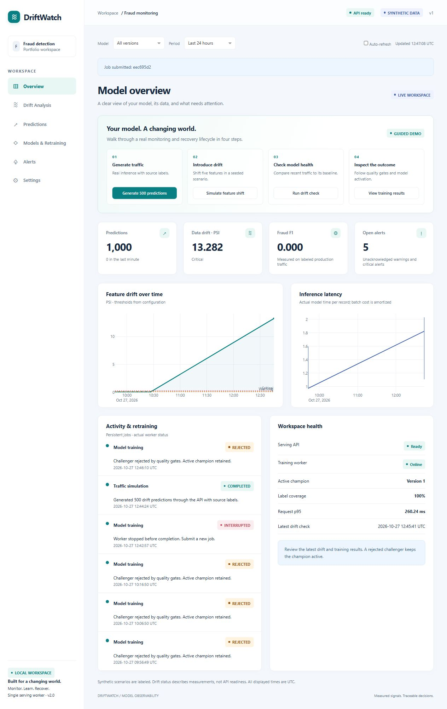
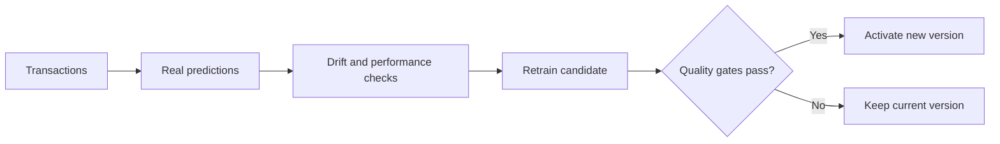

<div align="center">

# 🛡️ DriftWatch

### Your model learned yesterday. Is it still working today?

**Track changing data. Check model performance. Retrain with evidence.**

A working ML monitoring showcase for credit-card fraud detection, with real predictions,
automatic retraining, and a dashboard that explains what happened.

[See the dashboard](#a-look-inside) · [Run it locally](#run-it-locally) · [Try the demo](#a-demo-in-5-steps) · [Architecture](docs/architecture.md)

</div>

---

## The problem it solves

A fraud model learns patterns from past transactions. But spending habits change, new fraud
patterns appear, and incoming data can look different from its training data. The app may
keep returning predictions even when those predictions become less useful.

**DriftWatch helps you spot those changes and decide whether a new model is actually better.**
It watches incoming data, checks predictions against labels when available, trains a candidate,
and compares it with the active model before allowing a replacement.

Imagine a model trained on familiar spending patterns suddenly receiving a very different
mix of transactions. Here, you can introduce that shift, see the warning, follow retraining,
and inspect the decision in one place.

## The project in numbers

| Number | What it means |
| --- | --- |
| **6 dashboard pages** | Overview, Drift Analysis, Predictions, Models & Retraining, Alerts, and Settings |
| **3 drift checks** | Watch input data, prediction patterns, and labeled model performance |
| **4 local services** | Prediction API, dashboard, training worker, and MLflow UI |
| **500 predictions** | One guided traffic action sends 500 synthetic records through actual inference |
| **1–1,000 records** | Supported size of one batch prediction request |
| **40 automated tests** | Passed in each of 4 Windows/Linux × Python 3.11/3.12 CI environments |

These are implemented features and recorded verification results. The **500-record lifecycle
check also passed in Docker**, including retraining and restart persistence.
See the [verification evidence](docs/validation/2026-10-31/README.md).

## A look inside



| Page | What you can do |
| --- | --- |
| **Overview** | Check readiness, see the active model, and follow the guided demo |
| **Drift Analysis** | Explore changed features, compare distributions, and inspect thresholds |
| **Predictions** | Browse predictions, inspect labels, filter records, and export CSV |
| **Models & Retraining** | Follow training jobs, compare model scores, inspect quality gates, and roll back |
| **Alerts** | Search warnings and critical alerts, acknowledge them, and inspect delivery status |
| **Settings** | View configuration status and reset generated demo records with confirmation |

The interface includes responsive layouts, pause/resume refresh, explanatory empty states,
and visible labels for synthetic activity.

[Drift analysis](docs/screenshots/drift-desktop.png) · [Model comparison](docs/screenshots/models-desktop.png) · [Mobile view](docs/screenshots/overview-mobile.png)

## How it works

1. **Predict:** the API uses the active model to score transactions and records the results.
2. **Monitor:** compare incoming data and predictions with the model's saved reference data.
3. **Check outcomes:** use submitted labels to measure fraud-detection performance.
4. **Retrain:** a separate worker trains a candidate when a retraining job is triggered.
5. **Compare:** evaluate the active and candidate models on the same held-out transactions.
6. **Decide:** promote the candidate only if every required quality gate passes. Otherwise,
   keep the active model and show why the candidate was rejected.



The **champion** is the active model handling predictions. The **challenger** is the newly
trained candidate being tested for replacement.

### What are the 3 drift checks?

| Check | In easy words | How it is measured |
| --- | --- | --- |
| **Data drift** | “Do today's inputs look different?” | Feature distributions, using PSI and KL divergence |
| **Prediction drift** | “Has the pattern of model scores changed?” | Probability distributions, using Hellinger distance |
| **Performance / concept drift** | “Is the model doing worse on labeled examples?” | Changes in fraud-class F1, when enough labels are available |

A change in data does not automatically prove that the model is worse. Labels help check
whether predictions are still useful. Missing labels and insufficient samples are shown explicitly.

### The rules for replacing a model

The default quality gates use scores on a **0–1 scale**:

| Rule | Required result |
| --- | --- |
| Fraud F1 on the selected evaluation set | Improve by at least **0.005** |
| Fraud F1 on the fixed historical holdout | Drop by no more than **0.01** |
| Fraud recall on each evaluated set | Drop by no more than **0.02** |

**F1** balances how many fraud predictions are correct with how much fraud is caught.
**Recall** measures how much actual fraud the model catches.

The newest **20%** of unique new labeled records are reserved for recent evaluation.
That set needs at least **100 records**, including **5 examples of each class**. Otherwise,
the platform uses its fixed historical holdout and explains the fallback. Preprocessing is
fitted on training data only; historical holdout rows stay out of training. Thresholds are
configurable in [base_config.yaml](configs/base_config.yaml).

## Run it locally

Requires **Python 3.11 or 3.12**, or Docker with Compose. First, clone the project:

```sh
git clone https://github.com/Rahim36712/ML-Model-Drift-Monitoring-Automated-Retraining-Platform.git
cd ML-Model-Drift-Monitoring-Automated-Retraining-Platform
```

### Windows — one launcher

Open PowerShell in the project directory:

```powershell
.\start-demo.ps1
```

The launcher creates a virtual environment, installs locked dependencies, trains the first
model, and starts all **4 services** with readiness checks. First startup needs internet access
and may take several minutes. Later starts reuse the saved model. Press **Ctrl+C** to stop.

<details>
<summary>Manual Windows setup if PowerShell script execution is restricted</summary>

```powershell
py -3.12 -m venv .venv
.\.venv\Scripts\python.exe -m pip install --timeout 120 -r requirements.lock
.\.venv\Scripts\python.exe -m scripts.run_demo
```

Python 3.11 is also supported; use `py -3.11` when creating the environment.

</details>

### Docker

```sh
docker compose up --build
```

A named volume keeps models, jobs, and telemetry across restarts. Use `docker compose down`
to stop while keeping that volume. Published ports bind to `127.0.0.1`.

<details>
<summary>Linux / macOS manual setup</summary>

Use a supported Python 3.11 or 3.12 interpreter:

```sh
python3.12 -m venv .venv
source .venv/bin/activate
python -m pip install -r requirements.lock
python -m scripts.run_demo
```

Use `--no-browser` for terminal-only startup. Windows and Linux are covered by CI;
macOS has not been verified.

</details>

| Open | Address |
| --- | --- |
| **Dashboard** | [http://127.0.0.1:8050](http://127.0.0.1:8050) |
| **Interactive API docs** | [http://127.0.0.1:8000/docs](http://127.0.0.1:8000/docs) |
| **MLflow experiments and models** | [http://127.0.0.1:5000](http://127.0.0.1:5000) |

## A demo in 5 steps

1. **Generate traffic.** On Overview, confirm API readiness and an online worker. Click
   **Generate 500 predictions** and wait for the job to finish.
2. **Introduce a change.** Click **Simulate feature shift** to change **5 input features**
   in a seeded synthetic scenario. Records pass through real inference and feedback endpoints.
3. **Check drift.** Click **Run drift check**. Explore changed distributions, prediction
   patterns, label coverage, and the resulting alerts.
4. **Follow retraining.** Open **Models & Retraining**. Follow the job and compare the
   champion with the challenger on the displayed evaluation sets.
5. **Explain the outcome.** Show which gates passed or failed. If a new version was promoted,
   inspect its deployment history and demonstrate rollback to an available previous version.

**A rejected candidate is a valid outcome.** In the recorded 500-record verification runs,
the challenger failed its gates, so the platform kept champion version 1. The demo does not
force a promotion to make the presentation look successful.

Use the [5-minute presentation walkthrough](docs/showcase_walkthrough.md) for a ready-to-use
talk track. Install dependencies and train the baseline once before presenting.

## Built with

| Part | Technology | Job |
| --- | --- | --- |
| Model | scikit-learn Random Forest | Train the fraud classifier and generate predictions |
| API | FastAPI + Pydantic | Validate input and serve single/batch predictions |
| Dashboard | Dash + Plotly | Show monitoring, model comparisons, and guided controls |
| Experiments | MLflow | Track training runs, metrics, and model versions |
| Storage | SQLite + SQLAlchemy | Keep predictions, labels, jobs, alerts, and deployment history |
| Training | Separate Python worker | Process durable jobs outside prediction requests |
| Startup & checks | PowerShell, Docker Compose, GitHub Actions, pytest | Launch and verify the platform |

Batch inference is vectorized. The dashboard shares one snapshot endpoint for polling.
Each model version includes its own preprocessing and metadata. Activation switches a complete
serving snapshot, and failed activation preserves the previous snapshot.
See the [architecture](docs/architecture.md) for restart behavior and deployment boundaries.

## Data, configuration, and API

<details>
<summary>Use a compatible creditcard.csv</summary>

The default dataset and traffic scenarios are **synthetic**. Predictions, drift scores,
training, and evaluation are computed by the application.

A compatible CSV needs **29 numeric features** (`V1`–`V28` and `Amount`) and the binary label
`Class` (`0` = legitimate, `1` = fraud). Set `MLOPS_DATASET_PATH` to a trusted compatible CSV
**before the first training**. Use a new `MLOPS_HOME` for each dataset so the historical
holdout stays fixed. The source CSV is never modified.

Missing/nonfinite features, conflicting duplicate rows, and inadequate class samples are
rejected with an error. Arbitrary datasets and custom model uploads are outside this release.

</details>

<details>
<summary>Configuration, storage, and reset behavior</summary>

Runtime files default to `data/demo/`, separate from user-provided CSV files: telemetry,
jobs, MLflow data, model bundles, the fixed split, logs, and a generated management token.
`MLOPS_HOME` changes that location. Paths do not depend on the shell's working directory.

Edit YAML files in [configs](configs/) or environment settings in `.env`, then restart.
Settings shows configuration and notification status without exposing credentials.

Demo reset requires confirmation and clears only records tagged `demo`. User API predictions,
source data, models, and audit history are preserved. Prediction retention is
**30 days / 50,000 records**; job history and model versions remain available.

Jobs survive restarts. Duplicate training submissions reuse the active job, and interrupted
work is marked explicitly. Monitoring has sample requirements and a retraining cooldown.

</details>

<details>
<summary>Useful API endpoints</summary>

| Endpoint | Purpose |
| --- | --- |
| `GET /health`, `GET /ready` | Liveness/database access and loaded-model readiness |
| `POST /predict`, `POST /predict/batch` | Single and vectorized batch predictions |
| `POST /ground-truth/{id}`, `POST /ground-truth/batch` | Submit delayed binary labels |
| `GET /predictions`, `GET /predictions/stats` | Prediction records and summary statistics |
| `POST /drift/run`, `GET /drift/latest`, `GET /drift/history` | Run and inspect monitoring |
| `POST /models/retrain`, `GET /jobs/{id}` | Queue training and follow its progress |
| `GET /models/current`, `GET /models/versions` | Inspect the active model and available versions |
| `POST /models/rollback/{version}` | Activate a complete previous model bundle |
| `GET /alerts`, `POST /alerts/{id}/acknowledge` | Inspect and acknowledge alerts |
| `GET /dashboard/snapshot` | Read the dashboard's shared monitoring snapshot |

Management operations require `X-MLOps-Token`, from `MLOPS_TOKEN` or the generated
`MLOPS_HOME/.management-token`. Dash attaches it on the server; Swagger supports entering it
for protected operations. Keep credentials in environment configuration and use these
services on a trusted local machine.

</details>

## What has been verified?

Automated checks cover training, artifact reload, holdout isolation, drift edge cases, quality
gates, rollback, failed activation, concurrent predictions during activation, API validation,
authentication, job deduplication, recovery, and alert delivery failures.

- **40 tests passed per environment:** Windows and Linux with Python 3.11 and 3.12.
- **Docker passed:** image build, 4-service readiness, 500 labeled predictions, drift,
  real challenger evaluation, and restart persistence.
- **Local lifecycle passed on Python 3.11 and 3.12:** the model version and all 500 prediction
  records were preserved after restart.
- **Browser checks recorded:** all 6 pages, demo controls, CSV export, refresh controls,
  error/empty states, and desktop/mobile layouts.

[Verification reports](docs/validation/2026-10-31/README.md) · [Browser results and screenshots](docs/manual_validation.md) · [GitHub Actions](https://github.com/Rahim36712/ML-Model-Drift-Monitoring-Automated-Retraining-Platform/actions)

<details>
<summary>Run the checks yourself</summary>

From the installed virtual environment:

```sh
python -m pip check
python -m ruff check src scripts tests --select E9,F63,F7,F82
python -m pytest -q
python -m build
```

With the application running, use another terminal with the same environment configuration:

```sh
python -m scripts.smoke_test --report lifecycle.json
```

This submits 500 synthetic predictions with labels, runs drift checks, and follows real
challenger evaluation. For a read-only readiness check:

```sh
python -m scripts.smoke_test --check-only
```

</details>

## Scope and current limits

This is a **local portfolio showcase** for the existing fraud-detection use case, with one
serving owner. Public hosting, distributed serving, and arbitrary dataset/model configuration
are outside this release. Model improvement and zero-downtime deployment are not guaranteed.

Live SMTP/Slack delivery and a user-provided `creditcard.csv` have not been exercised.
Notification failure handling has automated coverage. Upstream deprecation warnings remain
visible in test/build logs. Full verification details are linked above.

---

**Built by [Rahim](https://github.com/Rahim36712).**
A project for showing the full path from a prediction to an evidence-based model update.
