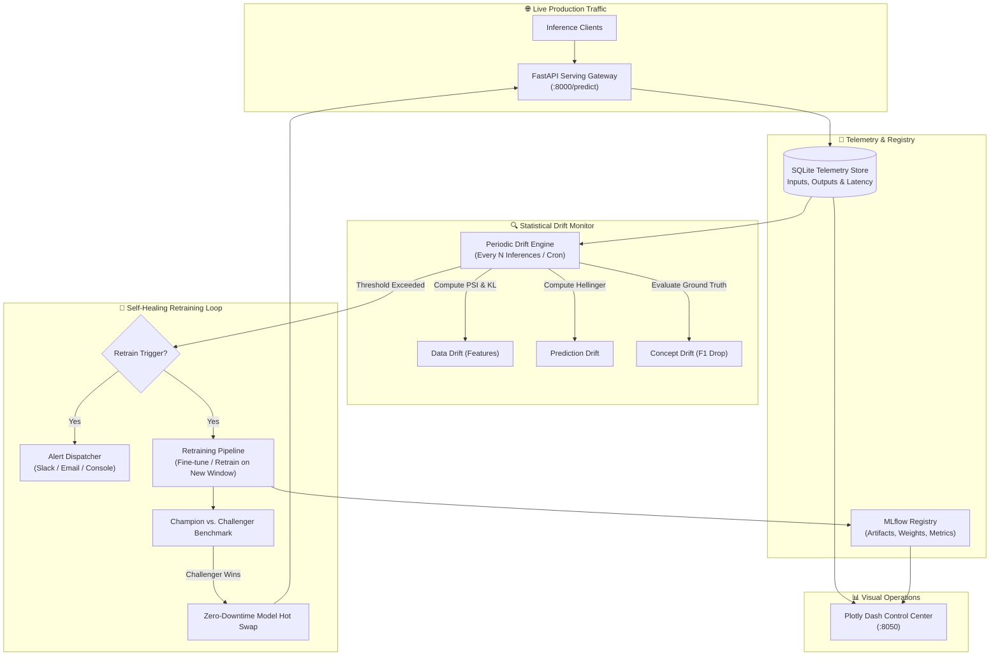

# 🤖 Self-Healing MLOps Platform — Automated Drift Monitoring & Retraining

<div align="center">

[](https://www.python.org/)
[](https://fastapi.tiangolo.com/)
[](https://mlflow.org/)
[](https://dash.plotly.com/)
[](https://scikit-learn.org/)
[](#-automated-testing)
[](src/decision/)
[](#-zero-downtime-champion-vs-challenger-pipeline)
[](LICENSE)

**An autonomous, production-grade MLOps platform that continuously monitors live machine learning models, detects data & accuracy drift via statistical metrics, triggers background retraining, and hot-swaps champion models with zero inference downtime.**

[Key Capabilities](#-key-capabilities) • [System Architecture](#-system-architecture) • [Drift Detection Engine](#-drift-detection-engine) • [Quick Start](#-quick-start) • [API Reference](#-api-endpoints) • [Dashboard](#-interactive-control-center)

</div>

---

## ⚡ Key Capabilities

- 📡 **Low-Latency Inference API**: Asynchronous model serving powered by FastAPI with telemetry logging and SQLite persistence.
- 📊 **3D Multi-Metric Drift Detection**:
  - **Data Drift**: Population Stability Index (PSI) and Kullback-Leibler (KL) Divergence across incoming feature distributions.
  - **Prediction Drift**: Hellinger Distance and Wasserstein metrics on model output probabilities.
  - **Concept Drift**: Rolling ground-truth evaluation detecting Precision, Recall, and F1 degradation.
- 🔔 **Multi-Channel Alert Dispatcher**: Immediate notifications dispatched across Slack, Email, and Terminal with smart anti-spam throttling.
- 🔄 **Autonomous Self-Healing Loop**: Background retraining triggered upon threshold breaches, with automated Champion vs. Challenger model tournament.
- 🚀 **Zero-Downtime Hot Swap**: Atomic in-memory model pointer swapping ensuring client inference remains uninterrupted during deployment.
- 📈 **Real-Time Control Center**: Dark-mode Plotly Dash monitoring UI displaying feature drift heatmaps, prediction histograms, and MLflow run comparisons.

---

## 🏗️ System Architecture



---

## 🔬 Drift Detection Engine

The monitoring service computes statistical divergence across sliding observation windows versus baseline reference data:

### 1. Population Stability Index (PSI)
Used to quantify distribution shift across continuous features:
$$\text{PSI} = \sum_{i=1}^{k} (A_i - E_i) \times \ln\left(\frac{A_i}{E_i}\right)$$
- $\text{PSI} < 0.10$: No significant change (Green).
- $0.10 \le \text{PSI} < 0.25$: Moderate drift detected; warnings flagged (Yellow).
- $\text{PSI} \ge 0.25$: Severe drift; automated retraining triggered (Red).

### 2. Hellinger Distance
Quantifies probability distribution drift on predicted classification probabilities:
$$H(P, Q) = \frac{1}{\sqrt{2}} \sqrt{\sum_{i=1}^{k} (\sqrt{P_i} - \sqrt{Q_i})^2}$$

### 3. Concept Drift (Performance Decay)
Continuously computes rolling macro-F1, ROC-AUC, and precision against delayed ground-truth labels. If $\Delta \text{F1} > 0.05$, the model is marked degraded.

---

## 🏆 Zero-Downtime Champion vs. Challenger Pipeline

When retraining completes:
1. **Candidate Training**: A challenger model is trained on combined historical and newly drifted production data.
2. **Offline Validation**: The challenger is evaluated against the current production champion on a strict holdout benchmark set.
3. **Safety Gate**: If and only if $\text{Metric}_{\text{Challenger}} > \text{Metric}_{\text{Champion}} + \epsilon$, the model is promoted in the MLflow Model Registry.
4. **Atomic Pointer Swap**: The FastAPI worker swaps the live model reference in memory with zero connection drops.

---

## 🚀 Quick Start

### 1. Installation & Environment Setup

```bash
# Clone the repository
git clone https://github.com/Rahim36712/ML-Model-Drift-Monitoring-Automated-Retraining-Platform.git
cd ML-Model-Drift-Monitoring-Automated-Retraining-Platform

# Create and activate virtual environment
python -m venv .venv
# Linux/macOS:
source .venv/bin/activate
# Windows:
.venv\Scripts\activate

# Install dependencies
pip install -r requirements.txt
```

### 2. Interactive End-to-End Demo

Run the orchestrator script to automatically spin up the API, simulate baseline and drifted production traffic, and trigger self-healing retraining:

```bash
python scripts/run_demo.py
```

- 📊 **Monitoring Dashboard:** [http://localhost:8050](http://localhost:8050)
- ⚡ **Interactive API Docs (Swagger):** [http://localhost:8000/docs](http://localhost:8000/docs)
- 📈 **MLflow UI:** [http://localhost:5000](http://localhost:5000)

### 3. Manual Component Execution

```bash
# 1. Train initial baseline model
python scripts/train_baseline.py

# 2. Launch FastAPI Inference Service
python -m uvicorn src.api.app:create_app --host 127.0.0.1 --port 8000 --factory

# 3. Launch Dash Analytics Dashboard
python -m src.dashboard.app

# 4. Stream simulated production traffic
python scripts/simulate_production.py
```

### 4. 🧪 Automated Testing

Run the full automated test suite verifying statistical drift computations, decision rules, telemetry logging, FastAPI prediction endpoints, and retraining deployment:

```bash
python -m pytest tests/
```
All **16 automated test suites** execute in `< 5s` verifying:
- Feature data drift detection (Population Stability Index & KL divergence)
- Output prediction drift calculation (Hellinger distance)
- Telemetry database persistence and thread-safe logging
- FastAPI REST inference contract (`/predict`, `/feedback`, `/monitoring/drift`)
- Retraining pipeline and champion model promotion logic

---

## 📡 API Endpoints

| Method | Endpoint | Description |
|:---:|---|---|
| `GET` | `/health` | Service health status and active model version. |
| `POST` | `/predict` | Real-time low-latency inference on feature payloads. |
| `POST` | `/predict/batch` | High-throughput batch inference. |
| `POST` | `/feedback` | Ingest delayed ground-truth labels for concept drift checks. |
| `GET` | `/monitoring/drift` | Summary of latest computed feature PSI and Hellinger metrics. |
| `POST` | `/monitoring/trigger-retrain` | Manually dispatch the retraining pipeline. |
| `GET` | `/models/current` | Active champion model metadata, hyperparameters, and MLflow run ID. |

---

## 📁 Repository Structure

```
ML-Model-Drift-Monitoring-Automated-Retraining-Platform/
├── configs/                  # YAML configurations (drift thresholds, retraining, alerts)
│   ├── alert_config.yaml
│   ├── drift_config.yaml
│   └── model_config.yaml
├── data/                     # Raw datasets & SQLite telemetry stores
├── docs/                     # Architectural guides & sequence diagrams
├── mlruns/                   # MLflow experiments, parameters & model artifacts
├── scripts/                  # Workflow orchestrators
│   ├── run_demo.py           # 1-click end-to-end self-healing demonstration
│   ├── simulate_production.py # Synthetic traffic & drift generator
│   └── train_baseline.py     # Initial baseline model trainer
├── src/
│   ├── alerting/             # Slack, Email & Console notification dispatchers
│   ├── api/                  # FastAPI inference gateway & telemetry middleware
│   ├── dashboard/            # Real-time Plotly Dash UI application
│   ├── data/                 # Data loaders, schema validators & drift injectors
│   ├── decision/             # Retraining trigger heuristics & rule engine
│   ├── models/               # Model training, evaluation & MLflow integration
│   └── pipeline/             # Background retraining workers & hot-deployers
└── tests/                    # Unit test suite covering statistical math & engines
```

---

<div align="center">
  <sub>Autonomous Machine Learning Engineering — Reliable, Measurable, Self-Healing.</sub>
</div>
