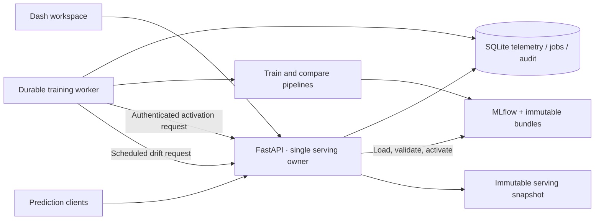

# Architecture

The API owns active serving state. Every inference reads one complete snapshot, so requests
already using the previous model finish consistently while activation installs a new snapshot.
Training runs in a separate process and never mutates a champion's scaler. The worker stores
job progress and requests API activation only after quality gates pass. The API validates the
complete bundle before changing registry/database state and the in-memory snapshot.

The database champion flag is authoritative across restart; startup reconciles the MLflow alias
and reloads that version. Failed activation restores the alias when possible and retains the
previous snapshot. A failed alias reconciliation is logged and repaired at restart. Registry,
SQLite, and memory do not form a distributed transaction, so this project does not claim a
zero-downtime deployment guarantee. The startup and worker locks enforce one owner per runtime.

Each job is durable, with a partial unique index enforcing a single active slot and transactional
claims. A worker heartbeat is independent of training progress. Interrupted jobs are marked
explicitly; deployment acknowledgment can be reconciled against serving readiness after restart.

Monitoring compares raw production features with raw per-version training references. Prediction
baselines use real held-out model probabilities. Concept checks require enough labeled examples
and both classes. Results are versioned in monitoring state and become stale after model changes.

The browser polls one filtered snapshot. Management credentials are attached by the Dash server
and never serialized into browser state. Ports bind to loopback in local mode and at the Docker
host. Public hosting requires an additional authentication/network design and is outside scope.
